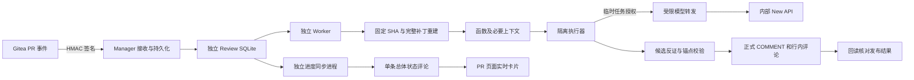

# AI Code Review 技术与部署说明

> 当前为质量修复候选：2026-09-12 的两轮 48 PR 实测整体质量未达标，尚未升级用户主环境。见 [质量修复验收报告](AIReview质量修复验收报告.md)。默认关闭，不能把工程链路通过等同于模型质量通过。

本功能提供辅助审查，默认全局关闭。生产端只配置内部 New API；官网模型只用于本机合成样本验收。模型效果与工程链路分别验收，当前发布链路见《AIReview直接发布验收报告》；历史模型质量见《AIReview验收报告》。第一期支持 Linux amd64、Gitea 1.26.4、UTF-8 的 C/C++ 文本变更；其他版本需要先完成适配验收。

**行内发布方式：** 本地校验后，使用现有机器人 Token，通过 Gitea REST API 一次创建正式 COMMENT Review，包含总结和可靠定位的行内评论。官方原版 1.26.4 可直接使用；不要求定制镜像、网页登录、机器人密码或草稿隔离补丁。

## 职责与数据流



Manager 复用现有管理员登录和服务器选择。新的写接口另加同源检查与 CSRF Token。Webhook 为独立 HMAC 入口，不使用管理员会话，不在请求中拉代码或调用模型。Worker 是单独进程，不加载 Manager 应用，不使用其 SSH、Docker socket 或管理数据库。执行器只收到 Worker 选择的文本；没有仓库挂载，不执行仓库脚本。

Review SQLite 使用 Linux 原生持久卷、WAL、短事务、条件领取和租约。默认同时执行一个 PR，20 秒合并连续 Push，90 秒租约、20 秒续期。任务连续中断三次后停止自动领取。网络调用不持有数据库事务；同一 PR 的发布另有进程文件锁。Worker 启动时校验存储是否支持进程锁与 SQLite 写锁。

数据库保存配置版本（不保存历史密钥明文）、仓库配置、事件签名摘要、执行代次、完整快照、候选及反证结果、Review ID 和失败状态。普通已结束任务的源码快照在 30 天后释放，发布结果不确定的证据继续保留。查询接口不返回解密凭据；任务列表不返回源码快照正文。

## 行内定位的保证与边界

每次执行固定仓库 ID、PR 编号、base、merge-base、head 和配置版本，读取整个 PR 的累计 diff。固定 SHA 文件还通过 Git blob SHA 校验。只有完整补丁逐字节应用后能重建新文件，才生成锚点；不能将截断补丁当成完整结果。

分析协议第 2 版把同名且唯一的修改函数合并为一个单元，`before` 始终表示修改前，`after` 始终表示修改后；旧侧删除行仍保留独立锚点。协议版本参与快照身份，避免复用旧分析实现的结果。

锚点绑定路径、修改侧、hunk、真实行号、原文和快照。模型只可引用当前分析单元提供的锚点；任意返回的路径或行号不进入发布接口。程序核对引用、快照及变更成员关系。相同函数内重复原文、空白、错误引用、未知锚点或反证未确认归属均降级普通意见。纯注释保留为上下文，不作为可执行缺陷的独立锚点。C++ 类和命名空间参与函数归属；前后同名函数无法区分时标记覆盖不足。

发布流程：

1. 获取同一 PR 的发布互斥，检查执行代次、租约、PR 开放状态及固定版本是否仍有效。
2. 再次核对本地锚点、快照、实际文件、修改侧、代码原文和行号。不可靠的位置降级普通意见；已有相同问题引用历史讨论。
3. 本地冻结实际发布内容，一次调用 CreateReview，提交 `event: COMMENT`、明确的 `commit_id`、整体 `body` 和已验证的 `comments`。没有可靠行内问题时只提交总结。
4. 回读正式 Review 与评论，核对机器人、任务标记、Review SHA、总结正文、评论集合、文件、修改侧和保存的 diff hunk，记录 Review ID 和结果链接。Gitea 的展示片段会截断到问题行、保留原 hunk 计数，并归一化 CRLF；只容许这些实测展示差异，其他字符仍严格一致。
5. 发布后再检查当前 PR；新版本重新入队，旧结果显示为历史版本。

正常路径不主动创建 PENDING，也不调用 SubmitReview。若服务端请求部分失败留下 PENDING，或机器人已有历史草稿，停止自动发布并显示“发布待核对”；不追加、不合并、不自动删除或续发。响应丢失时按任务标记只读核对，完整正式结果才确认成功。评论或总结不一致时保留远端结果与本地证据，不自动删除正式评论。

若核对确认原请求已经结束且没有发布，管理员可在任务列表选择“确认未发布”；服务器会再次检查无本任务 Review、无机器人待处理草稿后解除阻塞，随后由管理员人工重审。此操作不会清理 Gitea 数据，也不会自动重发。历史任务原记录保留，不批量补发旧评论。

**本轮已接受的限制：** 发布前已发现版本变化时禁止旧定位写入；但 Gitea 正在处理发布请求期间恰好发生 Push 的窗口尚未解决，不能保证这种情况下行内显示绝无错位。本轮定位验收以发布期间代码版本稳定为前提；这项并发保护另行优化，不以显式 SHA 或发布后回读冒充原子提交保证。

每个 PR 只维护一条机器人总体状态评论，由独立 `review-progress` 进程管理；正式 Publisher 仅保存已核验的 Review 引用。进度同步失败不改变正式发布结果。安装方法和会话认证兼容处理见 [PR 实时进度](AIReview进度使用与部署.md)。历史相同问题重新分析和定位后引用原 Review，不重复添加行内意见；历史引用能够跨越多次人工重审。模型判断真实缺陷与选择正确因果位置仍有误差，锚点校验不能代替缺陷语义验收。


分析候选必须包含前后行为、可复核事件序列、精确源码引用和根因操作 ID。反证阶段返回完整修订文案，最终意见采用修订后的触发条件、因果链、影响和建议。来源不匹配、引用不唯一或缺少前后对比证据的候选不作为确定缺陷发布，并记录覆盖不足。没有额外增加默认调用预算，也不会失败后偷偷切换模型。

根因位置另行核对：操作由语法树生成，必须包含所选变更行、处于相同修改侧，且有该版本修改函数的直接引用。两次判断的位置不一致、相邻准备行不属于根因操作、跨多条变更行的语法操作无法唯一定位时，降级普通意见。发布前从固定源码重新生成操作证据。此机制校验来源和位置成员关系，不能代替对业务语义的判断，也不能保证消除模型误报、漏报和错误推演。

任务详情兼容展示前后行为、状态序列、源码证据及降级原因。旧任务维持原结构与评论，不补发历史意见。模型原始结构化响应、实际输入及反证结果留在本地任务证据中，沿用 30 天释放规则；发布待核对的证据继续保留。任务详情仅管理员可读，密钥不进入证据。

## 执行引擎与资源限制

默认引擎为 OpenCode CLI 1.18.7；管理员可显式选择 New API HTTP。不会在失败后静默切换模型或提供商。两种引擎共用同一转发、输入选择、结构化输出、反证与发布校验。

OpenCode 使用固定 Linux amd64 二进制及内置兼容提供商，不在运行时安装 npm 包。每次调用采用独立 XDG、TMPDIR 和工作目录；禁用自动更新、模型目录下载、默认插件、项目配置、外部技能、Claude 配置、MCP、LSP 下载、分享、快照和自动压缩。工具权限全部 deny，单步执行。TMPDIR 隔离不可省略：本机实测 OpenCode 提取的动态库会在共享临时目录累积，已通过任务目录的生命周期统一清理。

执行器为非 root、只读根文件系统，移除 capabilities，不挂载 Docker socket、SSH、其他仓库或数据库；只有独立内部网络，并禁止外部 DNS 转发。上游真实 Key 只在 Worker 转发端解密，执行器使用限时、限模型、限调用次数的任务授权。

默认预算：40 个文件、32 次模型调用、20 项意见、1200 秒任务时间。单文件最多 128 KiB，整个源码证据最多 2 MiB，原始 diff 最多 2 MiB；单文件最多 5000 条变更行、整个任务最多 20000 个锚点。单个分析单元最多 48000 字符；最多读取 4 个本地头文件的前后版本。相关函数按调用关系和共享成员读写排序，在同一输入预算内补齐；小文件可包含全部函数，大文件的未提供范围逐项记录。达到预算、编码不支持或解析不完整会显示覆盖不足。没有编译数据库或硬件协议时不能承诺完整跨文件、跨线程或硬件语义分析。

## 内网部署

已有 Manager 现在优先使用 [一键升级与首次 AI 接入](一键升级与首次AI接入.md)：运行 `bash upgrade.sh`，随后在页面完成一次接入。以下分步流程保留给新建部署及人工诊断；一键升级不要求用户逐项生成密钥、编辑白名单或安装进度组件。

交付包含构建后的前端、Python wheels、固定 OpenCode、源码、脚本和离线运行镜像。Docker Engine 与 Compose 是宿主机前置条件。不得在内网运行 npm install、pip 联网安装或下载模型。

先导入包中的镜像：

```bash
docker load -i offline/运行镜像.tar
python3 scripts/review-runtime-prepare.py
```

准备不进入 Git 和交付包的秘密目录，例如 `/etc/gitea-manager/review-secrets`。主密钥必须持久备份；丢失后无法解密已保存的模型 Key、机器人 Token 和 Webhook secret。

```bash
sudo install -d -m 700 /etc/gitea-manager/review-secrets
sudo python3 - <<'PY'
from pathlib import Path
import os,base64,secrets
p=Path('/etc/gitea-manager/review-secrets')
for name,value,mode in [('master.key',base64.urlsafe_b64encode(os.urandom(32)).decode(),0o600),('executor.token',secrets.token_urlsafe(32),0o444)]:
 f=p/name
 if f.exists(): raise SystemExit('已有秘密文件，未覆盖：'+name)
 f.write_text(value); f.chmod(mode)
PY
```

在部署 `.env` 中填写现有 Manager 配置，以及：

```dotenv
# 此文件只保留在部署机，禁止提交。
SECRET_KEY=填写至少32字符的独立强随机会话密钥
INIT_PASSWORD=填写强管理员初始密码
AI_REVIEW_SECRET_DIR=/etc/gitea-manager/review-secrets
AI_REVIEW_GITEA_HOSTS=填写内部Gitea主机名
AI_REVIEW_MODEL_HOSTS=填写内部NewAPI主机名
AI_REVIEW_WEBHOOK_HOSTS=填写Gitea可访问的Manager主机名
```

白名单使用逗号分隔的精确主机名，不带协议或路径。生产机器的网络策略应仅允许访问授权内网服务。执行器网络不添加外部出口。模型地址填写完整 API 前缀，例如服务要求 `/v1` 时必须包含它；不支持带凭据、查询串或片段的地址，不跟随重定向。

AI Review 部署覆盖配置要求显式设置会话密钥与初始密码，不能沿用基础 Compose 中的公开默认值。已有数据库中的管理员密码不会被 INIT_PASSWORD 重置；变更 SECRET_KEY 后管理员需重新登录。秘密文件、环境配置和运行卷均不得加入交付包。

```bash
docker compose -f docker-compose.yml -f compose.ai-review.yml -f compose.ai-review.images.yml up -d --no-build --pull never
```

首次部署保持全局关闭。创建独立非管理员机器人，作为目标仓库的只读成员。Gitea Token 需 `read:user`、`write:repository`、`write:issue`；最后一项用于总体状态评论。Token scope 不会覆盖账号的仓库只读权限。系统会拒绝拥有 push 或 admin 权限的机器人。

在 Manager 的“AI Code Review”页面配置内部 New API 地址、Key 和实际模型，检查模型目录中是否存在所选模型。内网基线 `deepseek-v4-flash` 需要在实际服务验证，不可用时不能用官网别名冒充。然后添加仓库，填写机器人 Token，以既有服务器管理身份安装 Webhook，核对最近事件和 Worker 心跳，完成该仓库真实样本验收后才启用。

## 运维与验收脚本

- `scripts/review-offline-deploy-check.py`：从交付包校验文件与镜像，启动独立全新断网实例并执行真实 PR 链路；通过 `--help` 查看独立端口/网段参数。
- `scripts/review-local.py`：独立本机环境、合成用户与仓库、配置入口。凭据仅存 `work`，默认入口绑定回环地址。
- `scripts/review-fixtures.py`：50 个缺陷与正常对照样本。
- `scripts/review-direct-real-acceptance.py`：官方原版 1.26.4、真实 Git 与真实模型的直接行内发布，使用独立合成仓库。
- `scripts/review-real-acceptance.py`：真实 Git、Webhook、模型及 Gitea 回写；保存 SHA、任务和实际行号。
- `scripts/review-boundary-acceptance.py`：断网环境中的位置、故障、重启、rebase、force-push、人工重审与累计 diff。
- `scripts/review-publication-acceptance.py`：真实 Gitea 的直接发布、取 diff 与发布前版本变化、响应丢失、残留草稿和失效执行者验证（异常注入不代表模型质量）。
- `scripts/review-security-performance.py`：只读、网络、签名与响应时间实测。
- `scripts/review-endurance.py`：连续 OpenCode 执行和临时空间清理验证。
- `scripts/review-runtime-prepare.py --download`：仅在联网准备机准备缺失依赖；服务不会调用它。默认不下载，只校验 SHA-256。

模型 HTTP 错误、非法结构、超时或 CLI 失败会显示为任务失败；发布结果不确定时优先使用“核对发布”，不要直接重复发送评论。关闭全局或仓库开关会取消尚未发布的旧代次。已发布的开发者讨论不被清理。关闭功能不会停止 Gitea 提交、Push 或合并。

官方依据： [OpenCode CLI](https://opencode.ai/docs/cli/)、[提供商](https://opencode.ai/docs/providers/)、[权限](https://opencode.ai/docs/permissions/)、[Gitea 1.26.4 Review API 源码](https://github.com/go-gitea/gitea/blob/v1.26.4/routers/api/v1/repo/pull_review.go)、[Review 模型](https://github.com/go-gitea/gitea/blob/v1.26.4/models/issues/review.go)、[评论删除行为](https://github.com/go-gitea/gitea/blob/v1.26.4/models/issues/comment.go)。最终能力以本机真实测试及目标部署模型验收为准。
