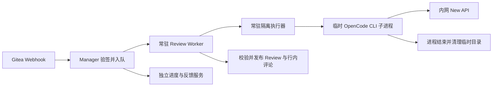

# 一键升级与首次 AI 接入

将 `gitea-manager.tar.gz`、`gitea-manager.tar.gz.sha256` 和 `upgrade.sh` 放到内网服务器同一目录，执行：

```bash
bash upgrade.sh
```

脚本识别已有 Manager；存在多个实例时选择目标。升级结束后继续使用原地址和原管理员密码。

首次打开 **AI Code Review → 快速接入 AI 审查**，填写内部 New API 地址和 Key，选择仓库，点击 **检查并启用**。默认模型为 `deepseek-v4-flash`，其他参数沿用现有默认值。已配置的模型地址、Key、机器人、Webhook 和仓库设置会保留，后续无需重填。只有 Gitea 无法回连时才出现回调地址修正项。

## 适用范围

- 已有 Docker Compose 部署、Linux x86_64、Linux 原生可靠本地 SQLite 持久卷；升级机已安装 Docker 和 Compose，运行账号有 Docker 权限。
- 已保存 Gitea 地址及管理 Token；本地目标通过已有 Docker socket，远程目标通过已有 SSH 私钥及 Docker 权限管理。Gitea 为官方 1.26.4，CustomPath 位于可写持久卷，支持模板热重载。
- 离线包带前后端镜像、OpenCode CLI 1.18.7、解析依赖、升级控制器和全部六个服务。目标机不需要安装 Python、Node 或在线拉镜像。模型仍由内网 New API 提供，不含模型权重。
- 不自动升级 Gitea 或其数据库服务。代码范围及审查质量边界见 [技术说明](AIReview技术与部署说明.md)。

## 升级期间

1. 核对包和镜像 SHA-256、架构、空间、原持久挂载及在途任务。备份、恢复、同步、策略应用、审查或初始化正在执行时，退出并保持原服务。
2. 冻结 Manager 六个相关服务，再检查一次任务状态，避免检查与备份之间进入新任务。备份 Manager/Review 数据库（含 WAL）、实际容器配置、密钥和旧镜像。现有 Gitea 备份文件保留在原目录，不额外复制大型备份文件。
3. 使用固定镜像 ID 生成配置，保留项目名、端口、挂载、账号和运行参数；补充缺失参数。已有 Review 库必须复用原主密钥，并能解密已有凭据。
4. 在共享维护标记下启动全部服务，暂停业务请求和后台领取任务，执行迁移、服务健康与历史记录核对。通过后解除维护；此前失败自动恢复数据库与旧配置并检查原服务可用性。

通常只需一条命令。只做预检可执行 `bash upgrade.sh --check`；无人值守且多实例时使用 `--container 已有后端容器名`。预检会导入包内镜像，但不停止服务。

升级记录位于原部署目录的 `.gitea-manager-upgrades/records/`，权限仅对部署管理员开放，包含敏感备份，不能公开分享。当前生效配置另存为 `compose.managed.json`。重复执行升级沿用现有卷和密钥，不重复创建实例。后续继续使用 `upgrade.sh`，不要覆盖解压到原数据目录或重新运行旧版 `deploy.sh`。

如果宿主机断电、Docker 守护进程退出或升级进程被不可捕获的强制终止，自动回退无法在已停止的进程中执行。执行锁会保留，防止第二次升级覆盖现场；应根据私有记录恢复上一次事务后再升级，不要直接删除锁或数据卷。已经解除维护后的版本不会自动用旧快照覆盖新产生的数据。

直接挂载应用源码、未持久化的有效 Review 库、数据库之外的不可靠共享盘、含符号链接的数据目录、数据卷内部的多层备份目录，以及无法读取原 Compose 文件的部署会被明确阻断。不能把这类部署当作已验收的自动迁移范围。

## AI 自动接入

后台记录每个仓库的回调验证、机器人与权限、Webhook 实际投递、进度组件安装结果。页面关闭或进程重启后继续同一任务；失败可点击“继续检查”。尚未完成的仓库不会新启用，原本已启用的仓库不因其他仓库失败被关闭。

机器人是独立非管理员账号，所选仓库只读。限定分类的 Token 支持读取用户、创建 Review 和评论，不赋予所选仓库代码写入权限。身份标记、账号 ID 和令牌密文持久保存；已有人工配置的有效机器人继续复用。CLI 的明文随机密码不记录，令牌回执只暂存在 Gitea 私有目录并在加密保存后清理。不确定且无法回读的令牌创建会停止，不盲目再次生成。

Webhook 先安装并回读，再验证真实签名投递。Gitea 1.26.4 的测试接口发送 Push 且受事件过滤，因此验证期间临时订阅 Push，完成即恢复；正式审查仍由 PR 事件触发。空仓库须先有首个提交才能完成投递验证。[Gitea 官方测试实现](https://github.com/go-gitea/gitea/blob/v1.26.4/routers/api/v1/repo/hook.go)、[事件过滤实现](https://github.com/go-gitea/gitea/blob/v1.26.4/services/webhook/webhook.go)。

进度组件通过现有 Docker/SSH 通道安装，先保留原模板，再原子替换受管理片段并热重载；不会重启 Gitea。主机名单保存在 Review 持久卷的 `hosts.json`，迁移旧部署值，各进程直接读取。只有管理端确认的地址可追加，模型响应和 Webhook 载荷不能扩大名单。

基础升级与 AI 接入分别报告结果。模型不可用、Key 无权限、Gitea 权限不足或回调不通，只会使接入检查失败，不会撤销已成功的基础升级。部署便利性、工程链路与模型审查质量分别验收，详见 [本轮验收记录](一键升级验收报告.md)。

## 运行流程



执行器容器常驻；每次模型分析或反证调用启动临时 CLI 进程，结束后回收进程和目录。不是每个 Webhook 启停一套容器。
